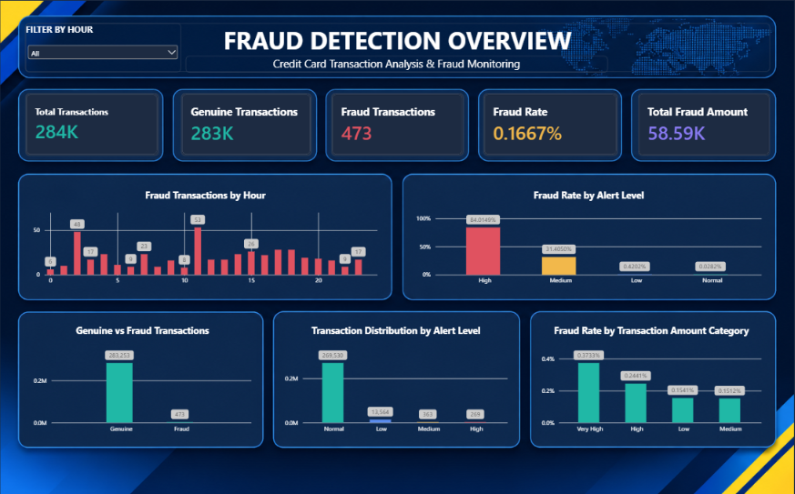

# 💳 Credit Card Fraud Detection Analysis

## 📌 Project Overview

This project focuses on analyzing credit card transactions and identifying fraudulent activities using Python and Microsoft Power BI.

It includes exploratory data analysis, transaction pattern analysis, and an interactive Power BI dashboard designed to monitor fraud trends and provide meaningful insights.

## 🎯 Project Objectives

- Analyze genuine and fraudulent transactions.
- Identify patterns in fraudulent activities.
- Monitor fraud rates across transaction categories.
- Analyze fraud trends by transaction hour.
- Understand fraud distribution across different alert levels.
- Present key insights through interactive visualizations.

## 📊 Dashboard Preview



## 📈 Key Performance Indicators

| Metric               |     Value |
| -------------------- | --------: |
| Total Transactions   |   283,726 |
| Fraud Transactions   |       473 |
| Genuine Transactions |   283,253 |
| Fraud Rate           |   0.1667% |
| Total Fraud Amount   | 58,591.39 |

## 📉 Dashboard Features

- Genuine vs Fraud Transactions
- Fraud Rate by Transaction Amount Category
- Fraud Transactions by Hour
- Transaction Distribution by Alert Level
- Fraud Rate by Alert Level
- Interactive Hour Filter

## 🛠️ Tools & Technologies

- Python
- Jupyter Notebook
- Pandas
- NumPy
- Matplotlib
- Seaborn
- Microsoft Power BI
- Power Query
- DAX

## 📂 Repository Structure

```text
Credit-Card-Fraud-Detection-PowerBI/
│
├── README.md
├── dashboard_preview.png
└── Credit_Card_Fraud_Analysis.ipynb
```

## 📁 Dataset Information

The original dataset and Power BI `.pbix` file are not included in this repository because of their large file sizes.

The Jupyter Notebook and dashboard screenshot are provided for project reference. The original dataset is required to reproduce the complete analysis.

## 🚀 How to Explore

1. Open `Credit_Card_Fraud_Analysis.ipynb` to explore the Python analysis.
2. View `dashboard_preview.png` to see the Power BI dashboard.
3. Review the project objectives, KPIs, and dashboard insights in this README.

## 👨‍💻 Author

**Adarsh Kate**

